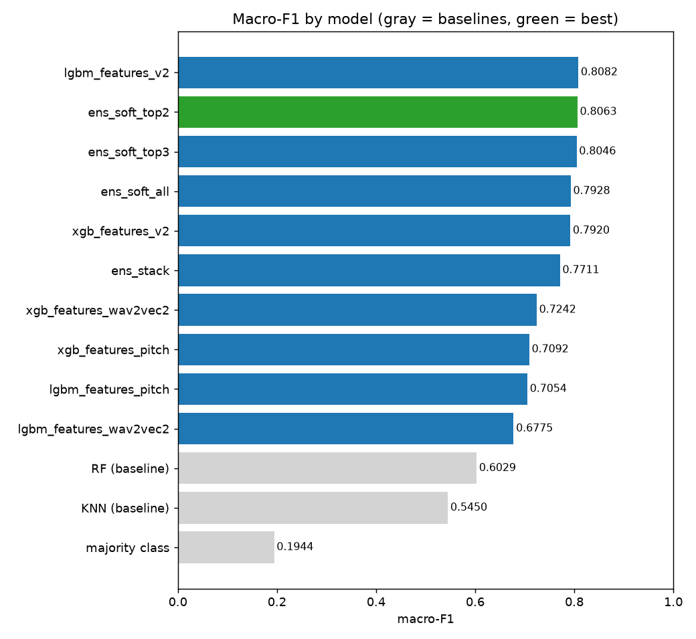
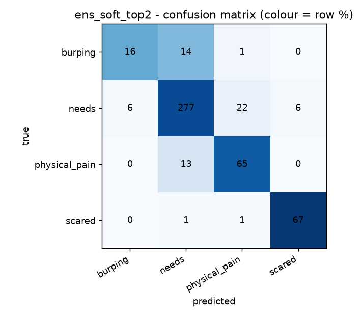

# Infant cry classification - results summary

## Models (test set)

| Model | Macro-F1 | Balanced acc | Accuracy | Test inference time |
|---|---|---|---|---|
| lgbm_features_v2 | 0.8082 | 80.68% | 87.32% | — |
| **ens_soft_top2** | 0.8063 | 80.28% | 86.91% | — |
| ens_soft_top3 | 0.8046 | 79.84% | 87.12% | — |
| ens_soft_all | 0.7928 | 78.51% | 86.71% | — |
| xgb_features_v2 | 0.7920 | 78.27% | 86.71% | — |
| ens_stack | 0.7711 | 81.28% | 83.23% | — |
| xgb_features_wav2vec2 | 0.7242 | 74.20% | 79.96% | — |
| xgb_features_pitch | 0.7092 | 70.22% | 81.19% | — |
| lgbm_features_pitch | 0.7054 | 71.22% | 79.96% | — |
| lgbm_features_wav2vec2 | 0.6775 | 70.86% | 76.48% | — |

## Baselines

| Baseline | Accuracy | Balanced acc | Macro-F1 |
|---|---|---|---|
| RF (reported) | 68.10% | — | 0.6029 |
| KNN (reported) | 59.30% | — | 0.5450 |
| Majority class (always one class) | 63.60% | 25.00% | 0.1944 |

## Best model: ens_soft_top2

## Findings

- **Best model:** `ens_soft_top2` reaches macro-F1 0.8063: +0.2034 vs RF, +0.2613 vs KNN, +0.6119 vs the majority-class baseline.
- **Largest gain:** (no usable ablation table) the biggest jump between adjacent models in the ranking is `ens_stack` over `xgb_features_wav2vec2` (+0.0470 macro-F1).
- **Weakest class:** burping (recall 51.6% on 31 test samples, most often confused with needs).
- **Augmentation:** could not be assessed (no matched aug / no_aug rows with macro-F1 in the ablation table).
- **Accuracy is misleading here:** always predicting the majority class already gives 63.6% accuracy but only 0.1944 macro-F1; the best accuracy comes from a different model (`lgbm_features_v2`).
